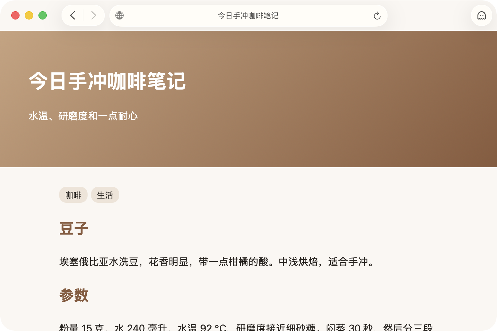

# Mochi

Mochi 把一个网页变成桌面上的浮窗，你在别的应用里工作时，也能用热键控制它，尤其适合边工作边看视频。



## 适合的场景

- **边工作边看视频或直播**：把视频放在屏幕角落，让它浮在最上层、半透明，点击会穿过它落到下面的应用上。
- **需要时一键藏起来**：有人走过来时按一下热键，窗口立刻消失，再按一下就回来。
- **不切换应用就能暂停、快进**：你在别的应用里打字时，也能用按键暂停、后退、前进视频。

## 系统要求

- macOS 26 或更高版本。
- 只支持 Apple 芯片的 Mac。

## 安装

1. 从 [Releases](https://github.com/asfamilybank/mochi/releases) 下载最新的 `Mochi-x.y.z.dmg`。
2. 双击挂载，把 `Mochi.app` 拖进旁边的「应用程序」快捷方式。
3. 第一次打开会被系统拦下，提示无法验证开发者或是否含有恶意软件。**这是预期内的**，不是下载坏了——Mochi 目前只做 ad-hoc 签名，没有 Apple Developer ID 证书与公证。按下面任一种方式放行一次，之后每次打开都不会再问。

**放行方式一：系统设置**

被拦下之后，打开「系统设置 › 隐私与安全性」，向下滚到「安全性」一节，那里会出现一行「已阻止使用 Mochi」，点它右边的 **「仍要打开」**，再在弹窗里确认。这行提示只在被拦下后的一小时内出现；错过了就再双击一次 `Mochi.app` 把它重新触发出来。

**放行方式二：终端**

直接去掉下载时被打上的隔离标记：

```bash
xattr -dr com.apple.quarantine /Applications/Mochi.app
```

> 网上流传的「右键 →『打开』」那条老办法在 macOS 15 之后已经被移除，照着做只会白折腾。

为什么会被拦下、放行是否安全，请看[为什么第一次打开会被拦下](docs/guide/explanation/unsigned-app.md)。以后换新版本请看[升级 Mochi](docs/guide/how-to/upgrade.md)，不想用了请看[卸载 Mochi](docs/guide/how-to/uninstall.md)。

## 开始使用

装好之后，跟着入门教程[上手：把视频放在桌面角落，边工作边看](docs/guide/tutorials/first-steps.md)走一遍，十几分钟就能学会核心用法。

## 用户手册

[用户手册](docs/guide/README.md)按用途分成四类：

- [教程](docs/guide/README.md#教程)：带你从头走一遍核心用法。
- [操作指南](docs/guide/README.md#操作指南)：教你完成某件具体的事，遇到问题时也从这里查故障排除。
- [参考](docs/guide/README.md#参考)：设置、快捷键、菜单、两种模式的对照，供随时查阅。
- [原理说明](docs/guide/README.md#原理说明)：讲清楚 Mochi 为什么这样设计。

## 反馈问题

遇到问题，可以先看手册里的[故障排除](docs/guide/how-to/troubleshooting.md)，按症状查原因和做法。

遇到问题或者有建议，请到 [GitHub Issues](https://github.com/asfamilybank/mochi/issues) 提交。

---

想参与开发，请看 [CONTRIBUTING.md](CONTRIBUTING.md)。
