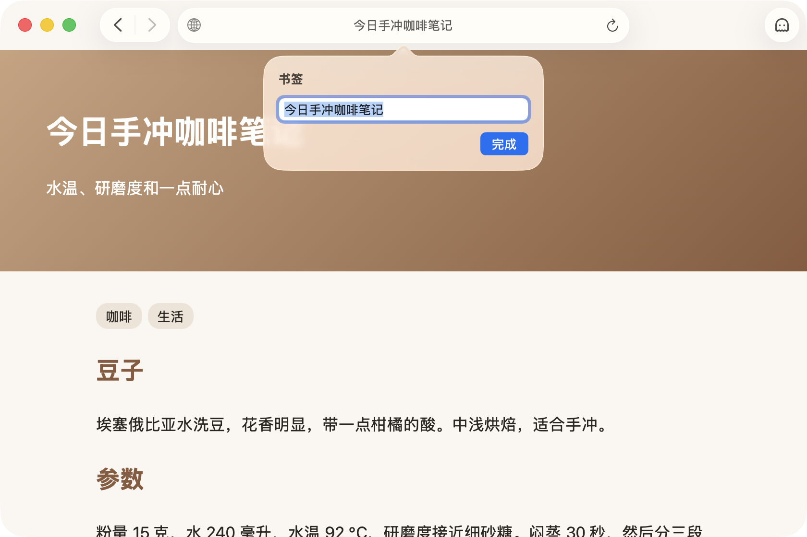
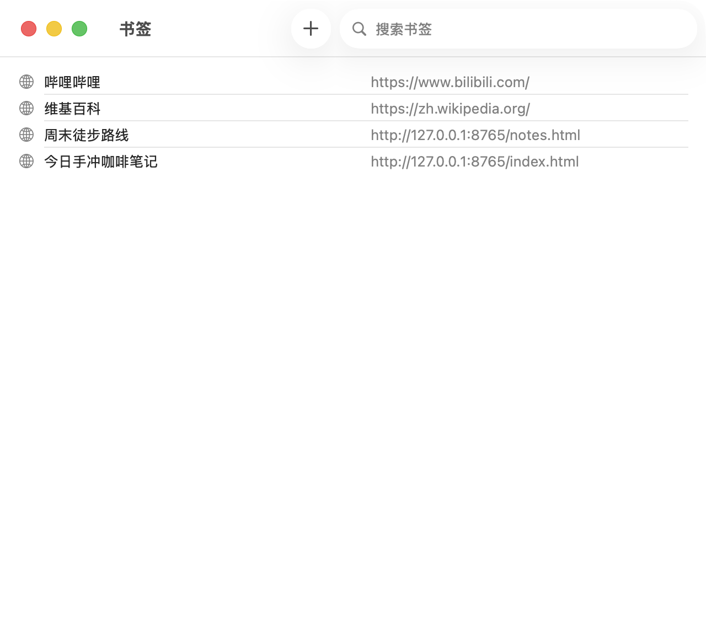

# 使用书签

把常看的网页存成书签，下次一步就能打开。Mochi 的书签是一份平铺的列表，顺序由你自己排。

## 添加书签

1. 在 Mochi 窗口里打开要存的网页。
2. 选择菜单栏的「书签 › 添加书签…」，或者按 ⌘D（Command + D）。
3. 书签马上就存好了，名称用的是网页标题（网页还没有标题时用网址）。同时地址栏下方会弹出一个小气泡，你可以在里面改名称：
   - 点「完成」、按 ↩（Return），或者点气泡外面，都会按你改过的名称保存。
   - 按 Esc 键会保留原来的名称，书签照样存着。

同一个网址只能有一个书签。当前网页已经是书签时，菜单里的这一项会变成「书签 › 编辑书签…」，按 ⌘D 只会打开气泡让你改名称，气泡里多了一个「移除」按钮，点它就删掉这个书签。

以下几种情况，「添加书签…」是灰的，按 ⌘D 也没有反应：

- 窗口关着，或者显示的是空页面。
- 当前页面不是 `http://`、`https://` 开头的网页。
- 窗口处于幽灵模式。先退出幽灵模式再添加。

## 打开书签

有三个地方可以打开书签：

- **「书签」菜单**：「添加书签…」「显示所有书签」下面按你排好的顺序列出全部书签，选中一个就打开。
- **地址栏**：点进地址栏、还没开始输入时，下拉列表会按顺序列出全部书签（没有书签时不弹出）。开始输入之后，书签会跟历史记录一起出现在建议里，名称和网址都能匹配，带书签标记的那一行就是书签。
- **书签窗口**：见下一节。

Mochi 窗口关着的时候，打开书签会先重新打开窗口，直接显示这个网页。窗口正处于幽灵模式时，会直接在窗口里打开这个网页，窗口仍然留在幽灵模式。

## 在书签窗口里整理书签

选择菜单栏的「书签 › 显示所有书签」，或者按 ⌥⌘B（Option + Command + B），打开书签窗口。书签窗口已经在最前面时，再按一次就把它关掉。

每一行左边是名称，右边是网址。在这里可以：

- **搜索**：在窗口右上角的「搜索书签」里输入文字，列出名称或网址里包含它的书签。
- **打开**：双击一行，或者选中一行后按 ↩。也可以点右键选择「打开」。一次只能打开一个书签。
- **编辑**：在一行上点右键，选择「编辑…」，可以改名称和网址，改完点「存储」。
- **拷贝网址**：选中一行，按 ⌘C，或者点右键选择「拷贝」。
- **删除**：选中一行或多行，按 ⌫（Delete），或者点右键选择「删除」。删除马上生效，不会再问一次。
- **排序**：直接拖动行。正在搜索时不能拖动，先清空搜索框。
- **新建**：点工具栏里的「新建书签」，填上「名称」和「网址」，点「存储」。新书签放在列表最后。

新建或编辑书签时：

- 「网址」按地址栏的规则理解，比如输入 `example.com` 就是 `https://example.com`。只能填网页地址，填了别的会提示「请输入网页地址，例如 example.com。」
- 「名称」留空，就用网址当名称。
- 这个网址已经有书签时，会提示「已存在：这个网址已经在书签里了。」，列表里会选中原来那个书签。
- 新建的书签一开始没有网站图标，第一次打开这个网页之后才补上。

## 清除数据不会删书签

书签只有你自己能删。清除历史记录、清除浏览数据、删除网站数据，都不会动到书签，书签的网站图标也会保留。见[清除浏览数据和网站数据](clear-data.md#什么不会被清掉)。

书签只存在你这台 Mac 上，存在哪里见 [Mochi 存放的数据与系统权限](../reference/data-and-permissions.md#数据存在哪里)。

## 为什么没有书签栏和文件夹

Mochi 一个窗口只放一个网页，没有标签页，书签只用来把当前网页换成另一个，所以只有一份平铺的列表，不需要书签栏和文件夹。见 [Mochi 是什么，不是什么](../explanation/what-is-mochi.md#为什么没有扩展书签栏书签文件夹和同步)。

## 遇到问题

见[故障排除](troubleshooting.md)。
