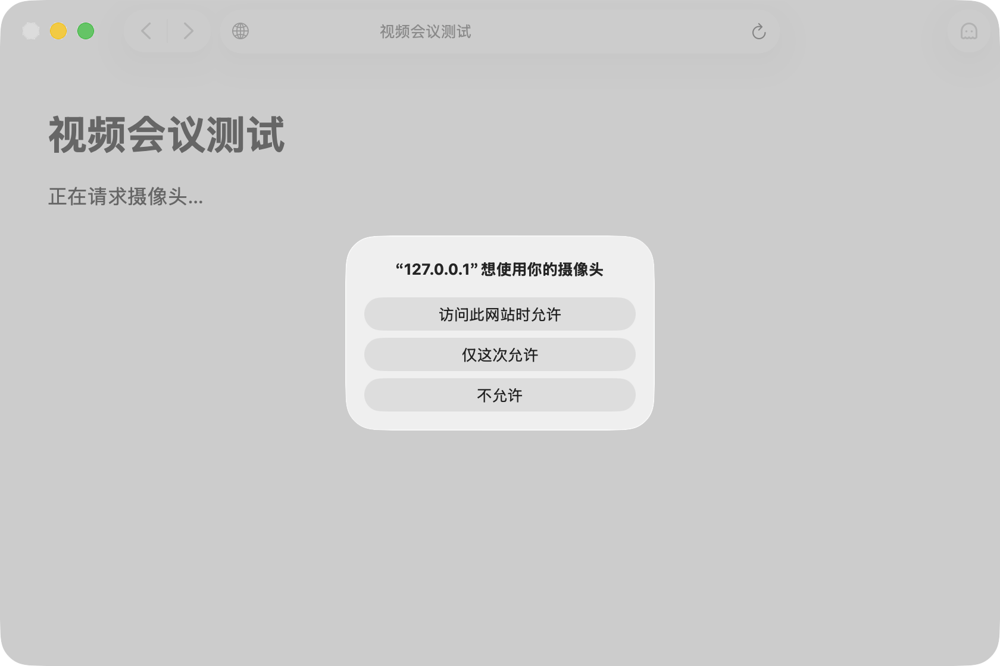
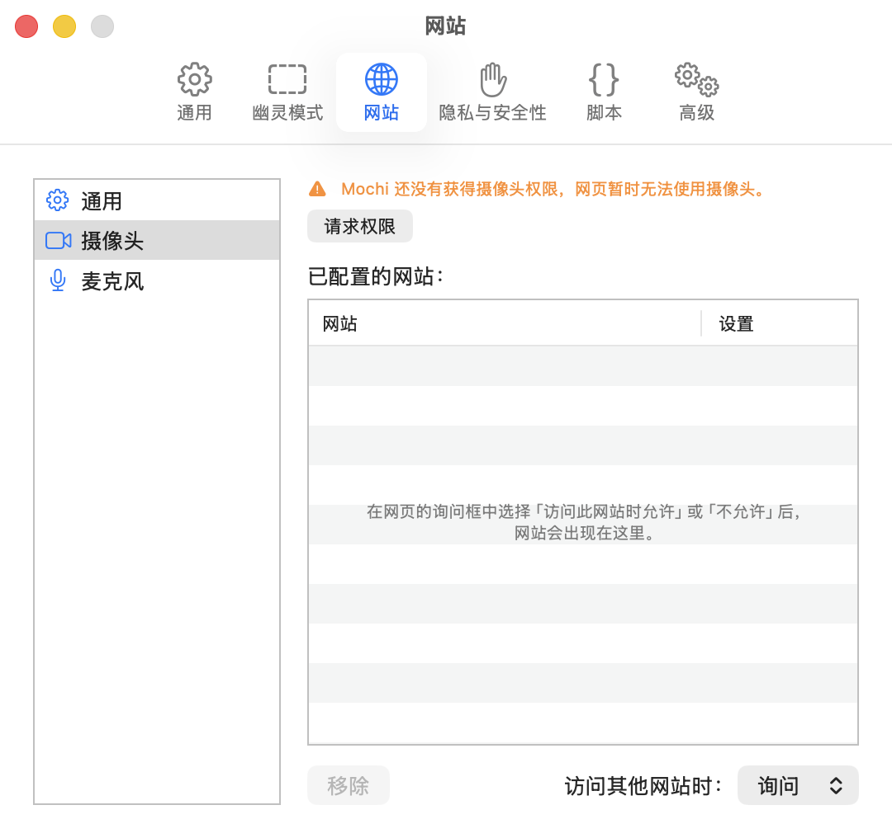

# 让网页使用摄像头和麦克风

在 Mochi 里开视频会议，网页要先过两道关才能用上摄像头和麦克风：

1. **网页权限**：Mochi 允不允许这个网站用。由你在 Mochi 的询问框里，或者在「设置 › 网站 › 摄像头」「设置 › 网站 › 麦克风」里决定。
2. **系统权限**：macOS 允不允许 Mochi 这个应用用。在「系统设置 › 隐私与安全性 › 摄像头」「系统设置 › 隐私与安全性 › 麦克风」里决定。

两道都过了，网页才能用。下面先讲网页权限，再讲系统权限。摄像头和麦克风是分开设置的，做法完全一样，下文以摄像头为例。

## 网页第一次要用摄像头时

网站第一次要用摄像头时，Mochi 会在发出请求的窗口上弹出一个询问框，标题写着是哪个网站、要用什么，比如「“meet.google.com”想使用你的摄像头」。网页同时要摄像头和麦克风时，只问一次，你的选择对两者都有效。

询问框里有三个选项：

| 选项 | 这一次 | 以后 |
|---|---|---|
| 访问此网站时允许 | 允许 | 记下来，这个网站以后再要就直接允许，不再问 |
| 仅这次允许 | 允许 | 不记。网页刷新、换到别的网页、或者关掉窗口之后，再要时还会问 |
| 不允许 | 拒绝 | 记下来，这个网站以后再要就直接拒绝，不再问 |

询问框没有默认按钮，按回车键不会替你选任何一项，免得一不小心就把摄像头永久交给了网站。按 Esc 键等于选「不允许」。

选了「访问此网站时允许」或「不允许」后，这个网站会出现在「设置 › 网站 › 摄像头」的列表里，以后可以随时改。

打开的是你电脑上的本地文件这类没有网站名的网页时，询问框只有「允许」和「不允许」两项，选什么都只管这一次，不会记下来。

## 「网站」是按什么算的

「网站」按**真正要用摄像头的那个页面的网址**算，具体是网址里的主机名：

- `meet.google.com` 和 `calendar.google.com` 算两个网站，分别询问、分别记。
- 很多网页把会议界面嵌在自己的页面里。这时算的是会议服务自己的网址，不是外面那个页面的网址。所以询问框里写的网站名，可能跟地址栏里的不一样，以询问框为准。

## 在设置里修改或移除网站

1. 按 ⌘,（Command + 逗号）打开设置，切到「网站」面板。
2. 在左边的列表里选「摄像头」（或「麦克风」）。
3. 「已配置的网站：」列表里是你在询问框里选过「访问此网站时允许」或「不允许」的网站，每一行右边是它的设置：「询问」「拒绝」或「允许」。
   - **改设置**：点这一行的设置，选另一项。比如把「允许」改成「询问」，下次就会重新问你。
   - **移除**：选中一行或多行，点左下角的「移除」，或者按 ⌫（Delete）。移除后，这些网站按「访问其他网站时」的设置处理。

想一次清掉很多网站的设置，也可以：

- 在「设置 › 隐私与安全性 › 网站数据 › 管理网站和数据…」里选中网站，点「重置权限」。
- 用「历史记录 › 清除浏览数据…」，选好时间范围，只勾选「网页权限例外」。这个对话框默认还勾着别的几项，不想清的记得先取消勾选。

## 修改其他网站的默认做法

「设置 › 网站 › 摄像头」右下角的「访问其他网站时：」，决定列表里没有的网站要用摄像头时怎么办：

- **询问**（默认）：弹出询问框问你。
- **拒绝**：直接拒绝，不问。
- **允许**：直接允许，不问。任何网站都能直接打开你的摄像头，除非你确实需要，不建议选这一项。

改了马上生效，从网页下一次请求起按新设置处理。

## 还要给 Mochi 系统权限

网页权限只是 Mochi 这一关。macOS 还要允许 Mochi 这个应用使用摄像头：

- Mochi 还没有获得摄像头权限时，网页第一次请求摄像头，系统会**先**弹出自己的提示「“Mochi”想访问相机」，选「允许」即可。之后 Mochi 才会弹出上面那个询问框，问你要不要让这个网站用。系统只问这一次。
- Mochi 还没获得这项权限时，「设置 › 网站 › 摄像头」顶部会显示提示：
  - 「Mochi 还没有获得摄像头权限，网页暂时无法使用摄像头。」：系统还没问过。点「请求权限」，按系统的提示选允许。
  - 「Mochi 的摄像头权限已被拒绝，网页无法使用摄像头。」：之前选了不允许。点「打开系统设置」，在「系统设置 › 隐私与安全性 › 摄像头」里打开 Mochi 的开关。
  - 「摄像头权限受管理策略限制，网页无法使用摄像头。」：这台 Mac 由公司或学校管理，你和 Mochi 都改不了，请联系管理员。
- 如果「访问其他网站时」是「拒绝」，列表里的网站也都是「拒绝」，网页根本过不了第一关，这个提示就不会出现。

## 在系统设置里改了之后，要重新打开 Mochi

拒绝过一次之后，在系统设置里再把 Mochi 的摄像头开关打开，**要退出并重新打开 Mochi 才会生效**。反过来，Mochi 正在用摄像头时在系统设置里关掉，也要重新打开 Mochi 才会被拒。

系统提示你退出并重新打开 Mochi 时，请照做。当时选了「以后」的话，就自己选菜单栏的「Mochi › 退出 Mochi」，再打开一次。只关掉窗口不算重新打开。见[故障排除](troubleshooting.md#在系统设置里打开了摄像头麦克风或文件和文件夹权限mochi-里还是用不了)。

## 收回授权后，正在开的会不会立刻断

在「设置 › 网站 › 摄像头」里把一个网站从「允许」改成「拒绝」或「询问」，或者把它移除，**正在进行的会议不会立刻断开**。已经拿到摄像头的网页，会一直用到它重新加载页面为止，这跟在系统设置里关掉权限要重新打开应用才生效是同一个道理。

想让收回马上生效，按 ⌘R（Command + R）或者选「显示 › 重新载入页面」刷新页面，或者关掉 Mochi 窗口。之后这个网站再要摄像头时，就按新设置处理。

## 幽灵模式下的请求会被直接拒绝

在幽灵模式下，Mochi 窗口里的网页要用摄像头或麦克风时，Mochi 直接拒绝，不弹出询问框，即使你在设置里允许过这个网站也一样。想开会的话，先按 ⌥G（Option + G）退出幽灵模式。

- 进入幽灵模式之前已经在用的摄像头和麦克风不受影响，会议照常进行。
- 登录小窗不跟着进入幽灵模式，它请求摄像头、麦克风时照常询问。

两种模式的完整对照，见[普通模式与幽灵模式对照](../reference/modes.md#网页发起的请求)。

## 遇到问题

- [在系统设置里打开了摄像头、麦克风或文件和文件夹权限，Mochi 里还是用不了](troubleshooting.md#在系统设置里打开了摄像头麦克风或文件和文件夹权限mochi-里还是用不了)

各项系统权限什么时候需要、在哪里改，见 [Mochi 存放的数据与系统权限](../reference/data-and-permissions.md#系统权限)。
