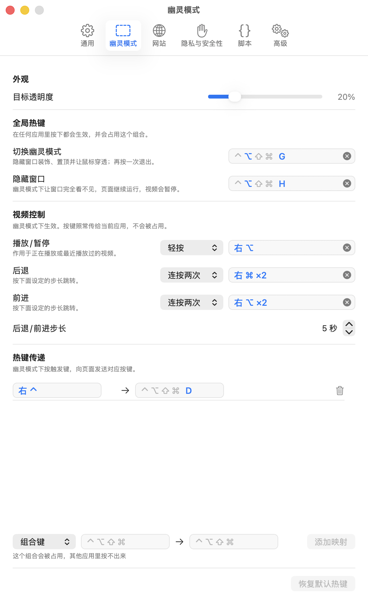

# 用幽灵模式让网页浮在最上层

幽灵模式让 Mochi 窗口一直浮在其他窗口上面、变成半透明，而你的鼠标和键盘照常作用于你正在用的应用。适合一边工作一边看视频。

## 进入幽灵模式

下面三种方式效果完全一样，任选一种：

- 按 ⌥G（Option + G）。这是「切换幽灵模式」的全局热键，在任何应用里按都有效，可以改成别的组合，见[修改全局热键](global-hotkeys.md)。
- 点工具栏最右边的幽灵图标按钮，鼠标停在上面时会显示「进入幽灵模式」。窗口很窄时这个按钮会被收起来，这时用另外两种方式。
- 点菜单栏里的 Mochi 图标（托盘图标），选「幽灵模式」。

窗口关着的时候进不了幽灵模式：托盘里的「幽灵模式」是灰的，按 ⌥G 也没有反应。先用托盘的「打开窗口」把窗口打开。

## 进入后会发生什么

下面几件事总是一起发生，不能只开其中一部分：

- **工具栏隐藏**：交通灯按钮、地址栏和所有工具栏按钮都不见了，只剩网页内容。
- **变透明**：窗口降到你设定的透明度，默认是 20%。
- **置顶**：窗口浮在其他应用的窗口上面。
- **点击会穿过窗口**：鼠标点在窗口上，实际点到的是下面那个应用。
- **不抢焦点**：你正在用的应用保持在前台，菜单栏也还是它的。如果进入时 Mochi 在前台，焦点会交还给你之前在用的那个应用。

为什么这几件事要绑在一起，见[幽灵模式为什么这样设计](../explanation/ghost-mode-design.md)。

## 退出幽灵模式

任选一种：

- 再按一次 ⌥G。
- 点菜单栏里的 Mochi 图标，选「幽灵模式」（进入幽灵模式后它前面有一个勾）。
- 点菜单栏里的 Mochi 图标，选「打开窗口」。
- 点 Dock 里的 Mochi 图标。

退出后窗口恢复成普通窗口：工具栏回来、不再透明、不再置顶，Mochi 成为前台应用，你可以直接操作网页。

窗口被[隐藏](hide-window.md)时也可以直接用上面的方式退出，窗口会重新显示出来。

## 调整透明度

1. 按 ⌘,（Command + 逗号），或者点菜单栏里的 Mochi 图标，选「设置…」。
2. 打开「设置 › 窗口模式 › 幽灵模式 › 目标透明度」，拖动滑块。滑块右边显示当前的百分比，数字越小窗口越透明。

松开滑块就生效。正处于幽灵模式时也能调：设置窗口是普通窗口，打开它不会让 Mochi 窗口退出幽灵模式，你可以边调边看效果。

调到 0% 时，幽灵模式下的窗口就完全看不见了。只是想临时把窗口藏起来，用[隐藏窗口](hide-window.md)更合适，不用改设置。

## 幽灵模式下不能做的事

窗口不接收点击，也不会成为前台窗口，所以凡是要操作窗口的事，在幽灵模式下都做不了：

- 点网页、在网页里打字、滚动网页。
- 拖动窗口、调整窗口大小。
- 刷新、停止、缩放、返回、前进：「显示 › 重新载入页面」「显示 › 放大」「历史记录 › 返回」这类菜单项都是灰的。
- 打开地址栏输入网址（「文件 › 打开位置…」），添加书签（「书签 › 添加书签…」）。
- 关闭窗口：先退出幽灵模式，再按 ⌘W 或点红色按钮。

想做这些事，先退出幽灵模式，做完再按 ⌥G 回去。

有两类操作不用退出：

- 控制视频的暂停、播放、后退、前进，用视频控制（默认轻按右 ⌥（右侧的 Option 键）播放 / 暂停），在「设置 › 窗口模式 › 视频控制」里设置，见[不切换应用就能控制视频](video-control.md)。
- 用网站自带的快捷键（比如开关弹幕），用热键传递，在「设置 › 窗口模式 › 热键传递」里设置，见[把热键变成网页按键](hotkey-forwarding.md)。

从历史记录或书签打开网页也不用退出：在「历史记录 › 显示全部历史记录」或「书签 › 显示所有书签」窗口里打开一个网页，Mochi 窗口会直接跳到那个网页，并且留在幽灵模式里。

## 网页这时发起的请求

幽灵模式下，网页发起的、需要你回应的请求都会被直接处理掉，既不会弹出来打扰你，也不会让 Mochi 退出幽灵模式：

- **对话框**：网页弹出的提示框自动关掉，需要你确认的一律按取消处理。网页要你选择文件上传时，也按取消处理。
- **摄像头和麦克风**：直接拒绝，不询问。即使你在「设置 › 网站」里允许过这个网站，幽灵模式下也一样拒绝。
- **下载**：不询问，直接存下来。「设置 › 通用 › 下载 › 文件下载位置」设成「每次询问」时，存到「下载」文件夹。
- **登录小窗**：不会打开。网页未经点击自行弹出的窗口也不会打开。

进入幽灵模式之前已经打开的登录小窗不受影响，它是普通窗口，可以照常操作。

每一项在两种模式下的具体差别，见[普通模式与幽灵模式对照](../reference/modes.md)。

## 重新打开 Mochi 后回到普通模式

退出 Mochi 再打开，或者关掉窗口再打开，窗口总是先回到普通模式，不会接着上次的幽灵模式。这是为了不让你在不知情的情况下，桌面上多出一个看不清、也点不到的窗口。原因见[幽灵模式为什么这样设计](../explanation/ghost-mode-design.md#为什么重新打开后总是回到普通模式)。

## 遇到问题

- [幽灵模式下点不到网页](troubleshooting.md#幽灵模式下点不到网页)
- [隐藏窗口后视频停了，恢复后没有继续播放](troubleshooting.md#隐藏窗口后视频停了恢复后没有继续播放)
