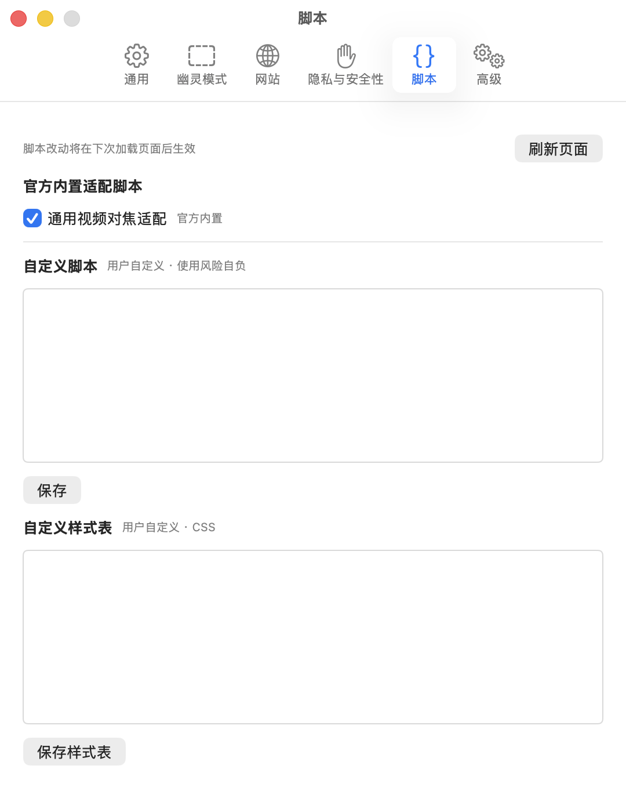

# 用脚本和样式表调整网页

这一页适合会写一点网页代码（JavaScript、CSS）的人：给常用的网站改改样式，或者加一点自动化。不写代码也完全可以正常使用 Mochi，这一页可以跳过。

所有相关设置都在「设置 › 脚本」里。按 ⌘,（Command + 逗号）打开设置，选「脚本」。



## 三种来源

「脚本」面板里的内容分三类，每一类旁边都标着来源：

| 类别 | 标注 | 是什么 |
|---|---|---|
| 「官方内置适配脚本」 | 「官方内置」 | Mochi 自带的脚本，随 Mochi 的版本一起更新。 |
| 「自定义脚本」 | 「用户自定义 · 使用风险自负」 | 你自己写的 JavaScript。 |
| 「自定义样式表」 | 「用户自定义 · CSS」 | 你自己写的 CSS。 |

三类在网页里的权限一样，区别只是谁写的。

## 官方内置适配脚本

目前只有一个：「通用视频对焦适配」，默认打开。

网页加载完之后，它把键盘焦点交给网页上的第一个视频。这样，热键传递发给网页的按键会落到播放器上，而不是落到搜索框或广告这类恰好拿着焦点的地方。

什么时候可以关掉它：某个网站打开后，你想在网页的输入框里打字，光标却总被抢走。取消勾选「通用视频对焦适配」，再刷新网页。

## 写自定义脚本

1. 在「自定义脚本」下面的框里写好或粘贴 JavaScript。
2. 点「保存」。改完不点「保存」，改动不会存下来。
3. 点面板顶部的「刷新页面」，让它在当前网页上生效。

想删掉脚本，清空框里的内容，再点「保存」。

脚本是这样运行的：

- **每次网页加载完运行一次**。网页已经加载完了才运行，所以等待网页加载事件的代码不会被触发，直接写要做的事即可。
- **对所有网站都运行**。只想对某个网站生效，就在脚本里自己判断网址。
- **只在 Mochi 窗口的主网页里运行**。网页里嵌入的其他网页（iframe）和登录小窗里不运行。
- **网页不重新加载、只换内容时不再运行**。有些视频网站切换视频时只换内容、不重新加载网页，这时脚本不会再跑一次。

例如，只在某个网站上去掉一块横幅：

```js
if (location.hostname.endsWith('example.com')) {
  document.querySelector('.banner')?.remove();
}
```

## 写自定义样式表

1. 在「自定义样式表」下面的框里写好或粘贴 CSS。
2. 点「保存样式表」。
3. 点面板顶部的「刷新页面」。

想删掉样式表，清空框里的内容，再点「保存样式表」。

样式表跟自定义脚本一样，在每个网站的网页加载完之后加上。它排在网页自己的样式后面，所以优先级相同时你的样式会生效；网页的写法更具体时，可以用更具体的选择器，或者加 `!important`。

因为样式表对所有网站都有效，选择器尽量写得具体一些，免得改到别的网站。

## 什么时候生效

面板顶部写着「脚本改动将在下次加载页面后生效」。打开、关闭内置脚本，保存自定义脚本或样式表，都要等网页下一次加载时才起作用。已经在网页里运行过的脚本没法撤回，所以删掉一段脚本之后，也要刷新网页才能去掉它的效果。

想马上看到效果，点面板顶部的「刷新页面」，或者在 Mochi 窗口里按 ⌘R。

## 风险：只粘贴你看得懂的代码

自定义脚本运行在网页里面，拥有跟网页一样的能力：能读到你在这个网页上看到和输入的一切，包括账号、密码和登录状态，也能把这些内容发出去。而且它对你打开的每个网站都运行。

- 只粘贴你自己写的、或者你能看懂每一行在做什么的代码。
- 别人发给你、让你“粘贴进去试试”的代码，看不懂就不要用。
- 发现网页表现异常，先清空自定义脚本和样式表并保存，再刷新网页，看问题是不是它们引起的。

## 相关页面

- [设置项一览：脚本](../reference/settings.md#脚本)
