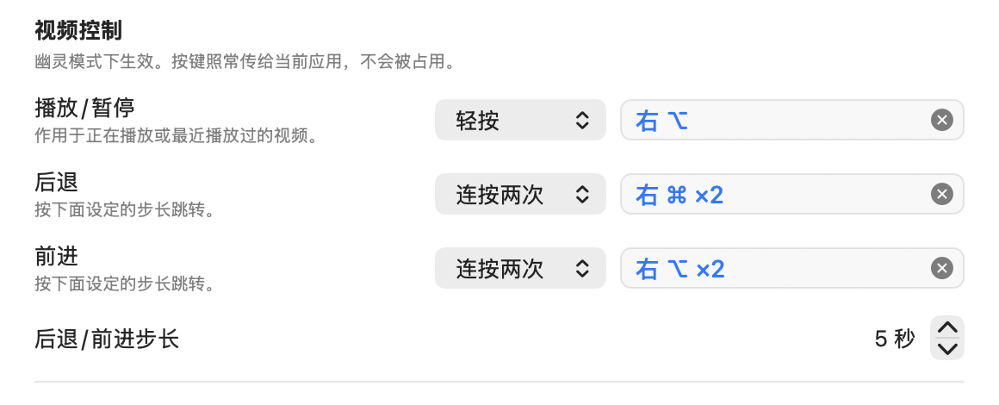

# 不切换应用就能控制视频

视频控制让你在别的应用里打字、开会时，也能暂停、播放、后退、前进 Mochi 里的视频，不用切换到 Mochi，也不用退出幽灵模式。

## 默认按键

| 功能 | 默认按键 |
|---|---|
| 播放/暂停 | 轻按右 ⌥（右侧的 Option 键） |
| 后退 | 连按两次右 ⌘（右侧的 Command 键），后退 5 秒 |
| 前进 | 连按两次右 ⌥，前进 5 秒 |

- **轻按**：单独按下一颗修饰键再松开，从按下到松开不超过半秒，中间不按别的键、也不点鼠标。左右两侧算两颗不同的键，左侧的 ⌥ 和 ⌘ 不受影响。
- **连按两次**：快速轻按同一颗修饰键两次，两下之间不超过约 0.3 秒。

这几个键不会影响你正在用的应用：单独按一下修饰键，在任何应用里都不会打出字符，也不会移动光标；而且 Mochi 只是在旁边听着，按键照常传给你正在用的应用，跟没装 Mochi 时一样。你用右 ⌥ 配合别的键打特殊字符时，中间按了别的键，不算轻按，视频不会有反应。

右 ⌥ 默认既管轻按（播放/暂停），又管连按两次（前进），所以轻按之后，Mochi 要等约 0.3 秒、确认你不是在连按两次，才暂停或播放。想让播放/暂停立刻响应，把「前进」改到别的键上，右 ⌥ 就只剩轻按这一种用法。

空页面的「热键」速览里，显示的是当前生效的按键，改过之后它也跟着变。

## 什么时候有效

- 只在[幽灵模式](ghost-mode.md)下有效，[窗口隐藏](hide-window.md)时也有效。隐藏期间按「播放/暂停」，视频会在看不见的窗口里接着播放，适合只想听声音的时候。
- 普通模式下没有作用：这时 Mochi 是一个普通窗口，直接在网页上操作就行。
- 窗口关着的时候没有作用。

## 控制的是哪个视频

页面上有好几个视频时，Mochi 按下面的顺序挑一个：

1. 正在播放的那个。同时有几个在播放，选最近开始播放的。
2. 都没在播放，选最近一次播放过的。
3. 都没播放过，选页面上看得见的部分最大的那个。

从没播放过、在屏幕上也完全看不见的视频（比如藏起来的预告片或广告）不会被选中。嵌在网页里、来自其他网站的播放器也算在内。

另外：

- 后退、前进不会越过视频的开头和结尾，也不会改变视频原来是在播放还是暂停。
- 直播没有固定的长度，后退、前进对它没有作用，播放/暂停照常可用。
- 「设置 › 网站 › 通用 › 自动播放」选了「永不自动播放」时，网页可能拒绝由视频控制开始的播放，这时按「播放/暂停」不会开始播放。

## 修改按键

1. 按 ⌘,（Command + 逗号），或者点菜单栏里的 Mochi 图标（托盘图标），选「设置…」，打开「热键」面板。
2. 在「视频控制」分组里找到「播放/暂停」「后退」或「前进」那一行，在右边的下拉菜单里选触发方式：「轻按」「连按两次」或「组合键」。
3. 选好后，旁边的录制框马上开始录制，框里分别写着「轻按一颗修饰键…」「连按两次修饰键…」「按下组合键…」。按下你想要的键，录下来就马上生效。

也可以直接点录制框开始录制，这时按下拉菜单里当前的方式录。

录制时：

- 按 Esc 取消，原来的按键保持不变，下拉菜单也变回原来的方式。点设置窗口里的其他地方，或者切换到别的窗口，也会取消。只选了一种触发方式、还没录到键，不算修改。
- 按 ⌫（Delete）清除这一项的按键。不在录制时，也可以点录制框右边的 ⓧ 清除。清除后这一项就没有按键了，想找回默认按键，用「恢复默认热键」，见[修改全局热键](global-hotkeys.md#恢复默认热键)。
- 录「轻按」或「连按两次」时按了普通键，这一行会提示「请轻按一颗修饰键」，并继续录制。
- 录「组合键」时，至少要带 ⌃（Control）、⌥、⌘ 之一，否则提示「组合键至少要有 ⌃ ⌥ ⌘ 之一」并继续录制。只有 F1 到 F20 这些功能键可以只带 ⇧（Shift），比如 ⇧F5。

### 用组合键时要注意

- 视频控制只是旁听，不会把按键拦下来：组合键在你正在用的应用里照常起作用。比如 ⌥P 在输入框里会打出“π”。最好选一个在你常用的应用里没有用处的组合。
- 不带 ⌃ 也不带 ⌘ 的组合键（比如 ⌥P、⇧F5）需要「辅助功能」权限，见下面的[需要辅助功能权限的按键](#需要辅助功能权限的按键)。
- 别的应用正在让你输入密码时，系统不让其他应用听到普通按键，组合键这时暂时不起作用；轻按和连按两次照常可用。

为什么会有这些区别，见[按键是怎么被 Mochi 听到的](../explanation/how-keys-are-heard.md)。

## 修改后退、前进的步长

在「设置 › 热键 › 视频控制 › 后退/前进步长」里点上下箭头调整，可以设成 1 到 60 秒，默认 5 秒。改完马上生效，空页面的热键速览也会写成新的秒数。

## 需要辅助功能权限的按键

只有把某个功能设成不带 ⌃ 也不带 ⌘ 的组合键（比如 ⌥P、⇧F5）时，才需要「系统设置 › 隐私与安全性 › 辅助功能」里的权限。默认按键、轻按、连按两次，以及带 ⌃ 或 ⌘ 的组合键都不需要。

设了这种按键之后，第一次处在幽灵模式时，Mochi 会请求一次这项权限；之后还缺的话，设置和托盘菜单里都会提示你。

- 怎么授予：见故障排除里的[幽灵模式下，视频控制的组合键（如 ⌥P）没反应](troubleshooting.md#幽灵模式下视频控制的组合键如-p没反应)。
- 每次升级 Mochi 后都要把它移除再重新添加：见[升级 Mochi](upgrade.md#重新添加辅助功能权限)。
- 为什么只有这类组合键需要：见[按键是怎么被 Mochi 听到的](../explanation/how-keys-are-heard.md#为什么有的组合键需要辅助功能权限)。

## 冲突提示

录下的键已经被 Mochi 的其他按键用上时，Mochi 不会改动这一项，而是在这一行的名称下面用红字说明原因，几秒后消失：

| 提示 | 意思 | 怎么做 |
|---|---|---|
| 与「切换幽灵模式」冲突、与「隐藏窗口」冲突 | 这个组合键已经是全局热键 | 换一个键，或者先在[修改全局热键](global-hotkeys.md)里把全局热键改掉 |
| 与视频控制「播放/暂停」冲突（或「后退」「前进」） | 另一个视频控制功能用的是一模一样的键和触发方式 | 换一个键，或者先改那个功能 |
| 与映射「…」冲突 | 热键传递里有一条映射用了这个触发键 | 换一个键，或者先删掉那条映射，见[把热键变成网页按键](hotkey-forwarding.md) |
| 这是 Mochi 菜单里的快捷键 | 这个组合是 Mochi 菜单里的快捷键，比如 ⌘R | 换一个键，哪些组合不能用见[快捷键与热键](../reference/shortcuts.md#不能设成热键的组合) |

同一颗修饰键，一个功能设成「轻按」、另一个设成「连按两次」，不算冲突，默认的右 ⌥ 就是这样。代价是这颗键的轻按要等约 0.3 秒才触发。

## 遇到问题

- [幽灵模式下，视频控制的组合键（如 ⌥P）没反应](troubleshooting.md#幽灵模式下视频控制的组合键如-p没反应)
- [升级后辅助功能开着，却不起作用](troubleshooting.md#升级后辅助功能开着却不起作用)
- [隐藏窗口后视频停了，恢复后没有继续播放](troubleshooting.md#隐藏窗口后视频停了恢复后没有继续播放)
