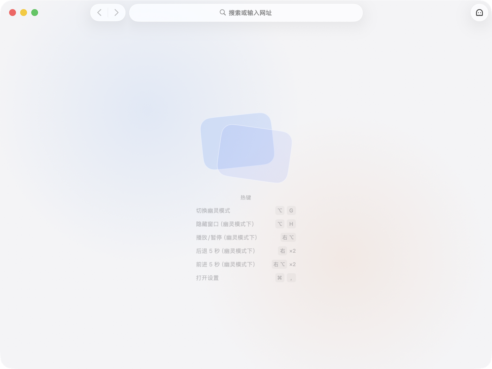
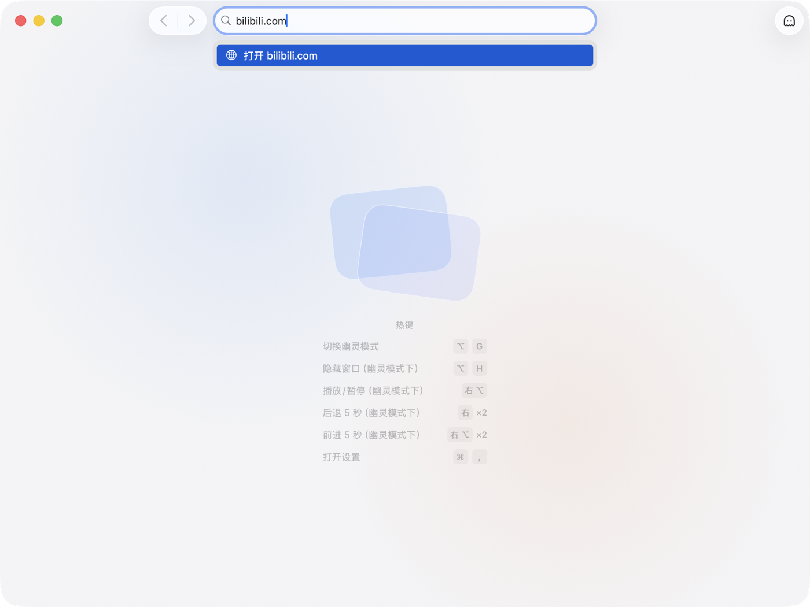
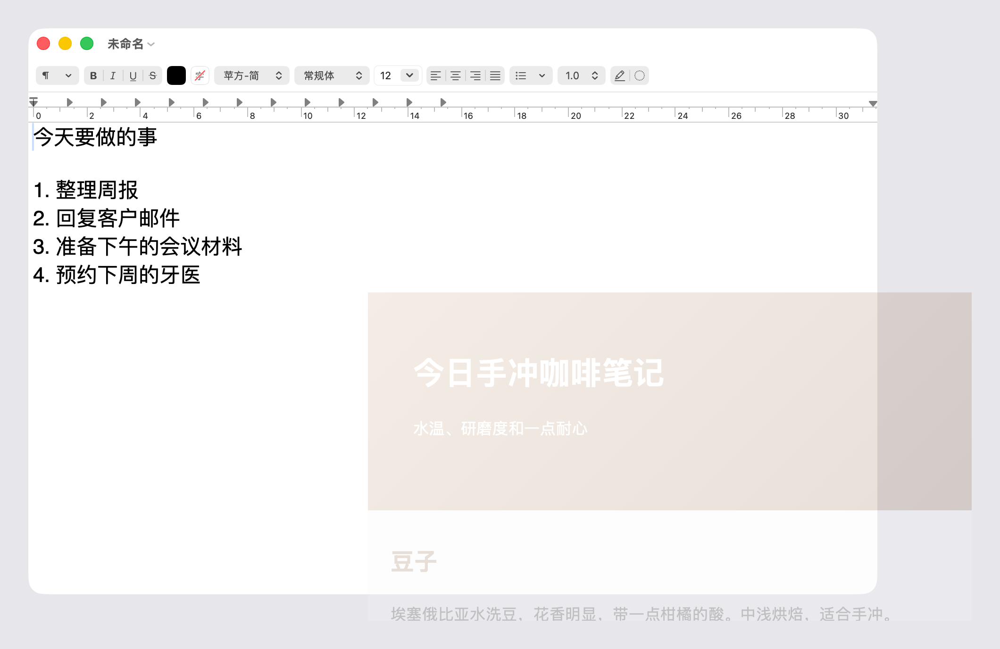
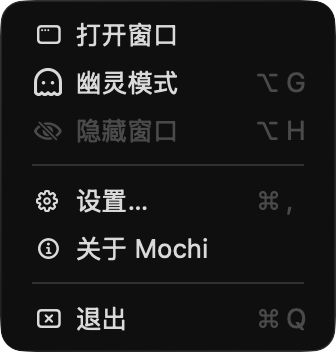

# 上手：把视频放在桌面角落，边工作边看

这篇教程带你从头走一遍 Mochi 的核心用法：打开一个视频网页，把窗口摆到屏幕角落，让它浮在最上层，然后一边在别的应用里工作，一边用按键控制视频。全程大约十几分钟。

走完之后，你会知道 Mochi 跟普通浏览器最大的区别：它的窗口可以变成一层半透明的“幽灵”，浮在你正在用的应用上面，却不挡你的鼠标和键盘。

## 开始之前

- 已经按 [README 的「安装」一节](../../../README.md#安装)装好 Mochi，并且打开过一次。
- 准备一个用来“工作”的应用，比如「备忘录」或「文本编辑」，后面要在里面打字。
- 最好戴上耳机或打开声音，这样暂停、播放时听得出来。
- 默认的视频控制按键用的是键盘**右侧**的 ⌥（Option）和 ⌘（Command）。Mac 自带的键盘两侧都有这两个键；如果你的键盘右侧没有，先照着走完其他步骤，再到[不切换应用就能控制视频](../how-to/video-control.md#修改按键)里换成别的键。

## 第 1 步：认识空页面

打开 Mochi。还没挪过窗口的话，它出现在主显示器的正中间，里面是**空页面**：它是 Mochi 自己的页面，不是某个网站。还没打开过任何网页时，Mochi 就显示它。

空页面中间有一份「热键」速览，列出现在生效的按键。默认是这样：

| 速览里写的 | 按键 | 什么意思 |
|---|---|---|
| 切换幽灵模式 | ⌥ G | 进入或退出幽灵模式，在任何应用里按都有效 |
| 隐藏窗口（幽灵模式下） | ⌥ H | 让窗口完全看不见，再按一次回来 |
| 播放/暂停（幽灵模式下） | 右 ⌥ | 轻按一下右侧的 Option 键 |
| 后退 5 秒（幽灵模式下） | 右 ⌘ ×2 | 连按两次右侧的 Command 键 |
| 前进 5 秒（幽灵模式下） | 右 ⌥ ×2 | 连按两次右侧的 Option 键 |
| 打开设置 | ⌘ , | 打开设置窗口 |

怎么读这张速览：

- 「×2」表示快速连按两次。
- 写着「（幽灵模式下）」的几项，只在幽灵模式下有效。现在窗口还在普通模式，按它们不会有反应，这是正常的。
- 你以后在设置里改了按键，速览会跟着变成新的按键。

再看一眼屏幕顶部的菜单栏：右侧多了一个 Mochi 图标，这是 Mochi 的**托盘图标**。只要 Mochi 在运行，它就一直在那里。后面有几步会用到它，遇到不知道怎么办的时候，点它总能找到出路。

## 第 2 步：打开一个视频网页

这里以哔哩哔哩为例。换成你常看的任何视频网站都可以，步骤完全一样。

1. 点一下窗口顶部工具栏正中间的地址栏，它里面写着「搜索或输入网址」。
2. 输入 `bilibili.com`，按 Return（回车）。不用写 `https://`，Mochi 会自动补上。
3. 网页打开后，点一个你想看的视频。它会在同一个窗口里打开：Mochi 一个窗口只放一个网页，没有标签页。

视频开始播放后，你会看到地址栏里显示的是网页的标题；鼠标移上去或者点一下，才显示网址。视频没有自己开始播放，就在网页上点一下播放按钮。

网站提示你登录时，不登录一般也能看。想登录的话，见[登录网站](../how-to/sign-in.md)。

地址栏还能直接搜索、给出建议，详见[打开网页与设置启动页](../how-to/open-pages.md)。

## 第 3 步：把窗口摆到屏幕角落

现在的窗口太大，会挡住你工作。把它缩小，放到一个角落里。

1. **调小**：拖动窗口右下角，把窗口缩到大约四分之一屏幕的大小，视频还看得清就行。窗口不能窄于一定宽度，免得工具栏挤不下。
2. **移动**：按住工具栏的空白处（地址栏两边没有按钮的地方），把窗口拖向屏幕右下角。
3. **感受吸附**：窗口的边缘靠近屏幕边缘时，会自己“啪”地贴上去，拖到角落就贴住两条边。它会贴在程序坞（Dock）旁边，不会压到程序坞上面。
4. **脱开**：想稍微离开边缘一点，就接着往反方向拖，离开一小段距离后窗口就不再贴着。

只有拖动整个窗口时才会吸附，拖窗口边缘改大小时不会。不想要吸附，可以在「设置 › 通用 › 窗口 › 拖动时吸附屏幕边缘」里关掉，见[摆放和关闭窗口](../how-to/window-placement.md#吸附屏幕边缘)。

窗口调得很窄时，工具栏最右边的幽灵图标按钮会先被收起来。没关系，下一步用按键进入幽灵模式就行。

Mochi 会记住窗口的位置和大小，下次打开时还在这里。

## 第 4 步：进入幽灵模式

按 ⌥G（Option + G）。也可以点工具栏最右边的幽灵图标按钮，鼠标停在上面时会显示「进入幽灵模式」。

窗口马上发生了这几个变化：

- **工具栏不见了**：左上角的红黄绿按钮、地址栏和其他按钮都隐藏起来，只剩网页内容。
- **变透明了**：窗口变得很淡，默认的透明度是 20%。
- **浮在最上层**：别的应用的窗口不会盖住它。
- **点击会穿过窗口**：鼠标点在它上面，点到的其实是下面那个应用。
- **不抢焦点**：你之前在用的应用回到前台，菜单栏也换成那个应用的。

动手试一下：

1. 切到「备忘录」（或者你准备好的那个应用），把它的窗口拖到 Mochi 窗口底下。Mochi 窗口仍然浮在上面。
2. 在 Mochi 窗口所在的位置点一下，再打几个字。点击和文字都进了「备忘录」，Mochi 窗口毫无反应。

所以，**幽灵模式下点不到网页，这是有意的设计，不是坏了**：它让视频一直看得见，又不挡你工作。想在网页上点东西，要先退出幽灵模式（第 7 步）。为什么这几件事要绑在一起，见[幽灵模式为什么这样设计](../explanation/ghost-mode-design.md)。

觉得太淡或者太显眼，可以调透明度：点菜单栏里的 Mochi 图标，选「设置…」，在「设置 › 幽灵模式 › 外观 › 目标透明度」里拖动滑块，数字越小越透明。这时 Mochi 不在前台，按 ⌘, 打不开设置，所以要从托盘图标打开。打开设置不会让窗口退出幽灵模式，你可以边调边看。

## 第 5 步：不切换应用就控制视频

继续留在「备忘录」里，光标停在正文里，像平时工作一样。

1. **暂停**：轻按一下右 ⌥（右侧的 Option 键），也就是单独按下再松开，中间不按别的键。视频暂停了。
2. **播放**：再轻按一次右 ⌥，视频接着播放。
3. **后退**：快速连按两次右 ⌘（右侧的 Command 键），视频往回跳 5 秒。
4. **前进**：快速连按两次右 ⌥，视频往前跳 5 秒。

轻按右 ⌥ 之后，视频要稍等约 0.3 秒才暂停或播放：右 ⌥ 同时管着「轻按」和「连按两次」，Mochi 要先确认你不是在连按。

整个过程中，「备忘录」里没有多出任何字符，光标也没动。单独按一下修饰键本来就不会打出字，而且 Mochi 只是在旁边听着，按键照常交给你正在用的应用。用这几个默认按键，也不需要给 Mochi 任何系统权限。

页面上有好几个视频时，Mochi 会选正在播放的那个。按键、触发方式和后退/前进的秒数都可以改，见[不切换应用就能控制视频](../how-to/video-control.md)。

按了没反应？先确认窗口还在幽灵模式里，再看[故障排除](../how-to/troubleshooting.md)。

## 第 6 步：一键隐藏窗口，再让它回来

有人走过来，不想让人看到你在看视频？用「隐藏窗口」，它相当于老板键。

1. 按 ⌥H（Option + H）。窗口立刻完全看不见了，视频和声音也一起暂停。
2. 再按一次 ⌥H。窗口回到原来的位置，仍然在幽灵模式里。

注意，窗口回来后**视频不会自己接着播放**，还停在你隐藏时的位置。想接着看，轻按一下右 ⌥ 就行，不用切换应用。这样设计，是因为你回来时往往要先看清画面、想起刚才看到哪儿，再决定什么时候继续，见[幽灵模式为什么这样设计](../explanation/ghost-mode-design.md#为什么隐藏时暂停视频恢复时却不自动播放)。

隐藏窗口只在幽灵模式下有效。普通模式下按 ⌥H 不会有反应。更多细节见[一键隐藏窗口（老板键）](../how-to/hide-window.md)。

## 第 7 步：回到普通模式

想在网页上点东西，比如换一个视频、拖动进度条，就要回到普通模式。任选一种：

- 再按一次 ⌥G。
- 点菜单栏里的 Mochi 图标，选「幽灵模式」（它前面有一个勾，表示正处于幽灵模式）。
- 点菜单栏里的 Mochi 图标，选「打开窗口」。

窗口恢复成普通窗口：工具栏回来了，不再透明，也不再浮在最上层，Mochi 成为前台应用。现在你可以像在浏览器里一样点网页了。

不管窗口在幽灵模式里变得多淡、藏在哪里，菜单栏里的 Mochi 图标总是点得到，它就是你随时可以用的那条退路。

想再回到幽灵模式，按 ⌥G 即可。以后就是这样来回切换：要操作网页时回普通模式，操作完再按 ⌥G。

## 第 8 步：关掉窗口，再重新打开

1. 在普通模式下按 ⌘W（Command + W），或者点窗口左上角的红色按钮。

   窗口关掉了，视频也停了。这是**真的关闭**，跟第 6 步的隐藏窗口不一样：网页不再运行。

2. 看看菜单栏和程序坞：Mochi 图标都还在。Mochi 本身没有退出，只是没有窗口了。这时按 ⌥G、⌥H 都不会有反应，因为没有窗口可以切换。
3. 点菜单栏里的 Mochi 图标，选「打开窗口」，或者点程序坞里的 Mochi 图标。窗口重新打开了：
   - 位置和大小跟关闭前一样，还在你摆好的角落。
   - 处于普通模式。重新打开窗口、重新启动 Mochi，都总是先回到普通模式。
   - 显示的是你最后一次自己在地址栏里打开的网址，也就是哔哩哔哩的首页，而不是你后来在网页里点进去的那个视频。网页从头加载。

想让 Mochi 每次打开时显示别的东西，比如空页面或者固定的某个网址，在「设置 › 通用 › 启动 URL › 启动时」里改，见[打开网页与设置启动页](../how-to/open-pages.md#设置每次打开时先看到什么)。

想让 Mochi 完全停下来，按 ⌘Q，或者点菜单栏里的 Mochi 图标，选「退出」。下次打开 Mochi 时，跟刚才重新打开窗口的样子一样。

## 你学会了什么

| 想做的事 | 怎么做 |
|---|---|
| 打开网页 | 在地址栏输入网址，按 Return |
| 摆放窗口 | 普通模式下拖动，靠近屏幕边缘会自动贴齐 |
| 进入 / 退出幽灵模式 | ⌥G，或点菜单栏里的 Mochi 图标 |
| 暂停 / 播放 | 幽灵模式下轻按右 ⌥ |
| 后退 / 前进 5 秒 | 幽灵模式下连按两次右 ⌘ / 右 ⌥ |
| 隐藏 / 恢复窗口 | 幽灵模式下按 ⌥H |
| 关闭窗口 | 普通模式下按 ⌘W |
| 重新打开窗口 | 点菜单栏里的 Mochi 图标，选「打开窗口」，或点程序坞里的 Mochi 图标 |

## 接下来可以看什么

- [不切换应用就能控制视频](../how-to/video-control.md)：换成顺手的按键，或者改后退/前进的秒数。
- [用幽灵模式让网页浮在最上层](../how-to/ghost-mode.md)：幽灵模式下网页弹框、下载文件时会怎样，还有哪些事做不了。
- [设置项一览](../reference/settings.md)：每个设置项是做什么的、默认是什么。
- [把热键变成网页按键](../how-to/hotkey-forwarding.md)：在幽灵模式下用网站自带的快捷键，比如开关弹幕。
- [修改全局热键](../how-to/global-hotkeys.md)：⌥G、⌥H 跟你常用的其他应用冲突时，换成别的组合。
- [故障排除](../how-to/troubleshooting.md)：按症状查原因和做法。
